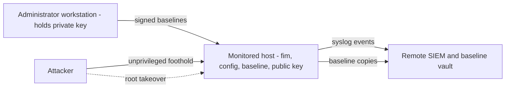

# Threat model

## Assets

| Asset | Why it matters |
|---|---|
| Monitored files (config, binaries, boot chain) | Their modification is what we want to detect |
| Baseline + signature + audit trail | The reference of truth; forging it hides changes |
| Signing private key | Allows forging baselines |
| Reports and syslog stream | Evidence for responders |
| The scanner itself (code, venv, config) | A tampered scanner reports lies |

## Actors and trust boundaries

Trust boundary 1 is the host itself (everything on it is attacker-reachable after root). Boundary
2 separates the host from the admin workstation and SIEM; the controls that matter against root
live across that line.

## Threats (STRIDE-oriented) and mitigations

| # | Threat | Mitigation in FIM | Residual risk |
|---|---|---|---|
| T1 | Attacker modifies a monitored file | Hash/metadata comparison; severities; risk flags | Undetected between scans; reverted before scan |
| T2 | Unprivileged attacker edits the baseline to bless a change | Dir mode `0700`/owner check; self-hash; signature; audit cross-check | None for unprivileged users |
| T3 | Root attacker edits baseline and recomputes hash | Signature with off-host key | If key on host: undetectable |
| T4 | Root attacker replaces `fim`/Python/config/public key | None locally | **Unmitigated on-host**; mitigate with off-host verification and rebuilds |
| T5 | Rollback to an older (validly signed) baseline | Audit-chain cross-check; `prev_sha256` | Root can rewrite audit; off-host copy detects |
| T6 | Deleting the `.sig` to disable verification | Missing signature is a hard failure when `public_key` set | Root can remove `public_key` from config |
| T7 | Symlink race: swap a file for a symlink to hash something else or to make FIM read secrets | `lstat`/`O_NOFOLLOW`/inode check; no follow outside roots by default | Inode-reuse corner case |
| T8 | Hostile directory trees to exhaust resources (huge, deep, loops, FIFOs) | `max_files`, `max_depth`, `max_file_bytes`, timeout, loop detection, specials never opened, `one_file_system` | Disk/IO impact up to limits |
| T9 | Hiding in the gaps: make files unreadable or churning so scans are "clean" | Issues reported, scan incomplete (exit 3), no false deletions or false clean | Operators must act on exit 3 |
| T10 | Malformed config / path traversal (`../`, relative, NUL) | Strict Pydantic schema, absolute + `..`-free paths, baseline-location check, `--root` must lie under configured roots | Config file itself is trusted input (root-owned) |
| T11 | Output injection: hostile filenames in CSV, syslog, CEF, terminal | CSV formula prefixing; RFC 5424 SD and CEF escaping; JSON encoding | Filenames with control chars shown raw in text report |
| T12 | Report/key/baseline overwritten or redirected via symlink | Exclusive creation, no overwrite by default, symlink refusal, `0600` | n/a |
| T13 | Concurrent writers corrupt the baseline | `flock`, unique versions, atomic link-based publish | NFS locking semantics |
| T14 | Supply-chain compromise of dependencies | Hash-pinned `requirements.lock`, `pip-audit`, dependency-review, Dependabot | Upstream compromise before pinning |
| T15 | Leaked signing key | `.gitignore`, secret scanning in CI, mode checks, location refusals, passphrase option | Operational discipline |
| T16 | Alert suppression by killing watcher/timer | Documented; monitor the unit | Not enforced by FIM |
| T17 | Information disclosure through reports (paths, hashes) | Reports `0600`; baseline dir `0700` | Reports contain file inventory: protect them |

## Out of scope

Kernel/hypervisor/firmware compromise, physical access, attacks on the SIEM, side channels,
availability attacks beyond the stated resource limits, and detection of malicious *content*
(FIM detects *change*, not maliciousness).

## Security assumptions to verify in your deployment

1. Baseline created from a clean state. 2. Signing key off-host. 3. Alerts forwarded off-host.
4. Config and `/opt/fim` are root-owned and not writable by service accounts. 5. Time source is
trustworthy (timestamps are evidence).
