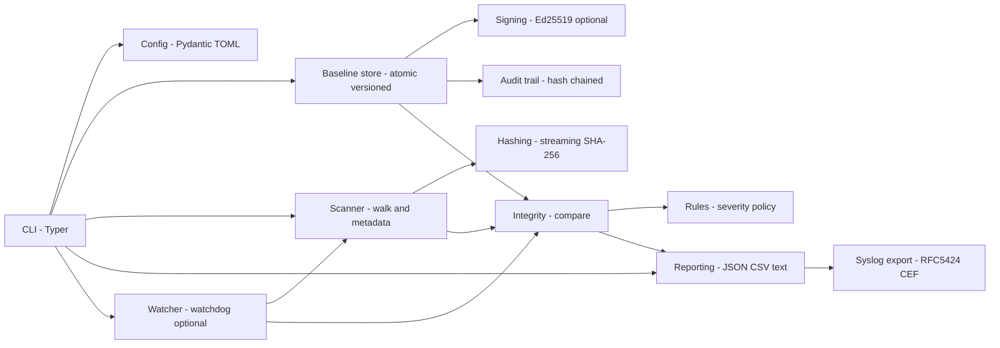
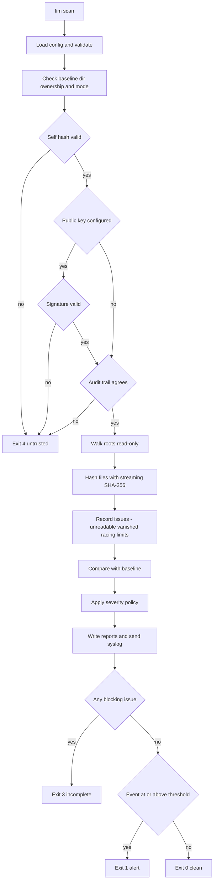

# User guide

## Concepts

* **Baseline**: an immutable, versioned JSON snapshot of the monitored roots, with a SHA-256
  content hash over its own body, an optional detached Ed25519 signature, and a pointer
  (`CURRENT`) plus a hash-chained **audit trail** next to it.
* **Scan**: a fresh read-only walk compared against the baseline. Output: events (what changed)
  and issues (what could not be verified).
* **Incomplete scan**: any blocking issue (unreadable file, vanished file, file changed while
  hashing, directory that could not be listed, size/time/depth limits, missing root). An
  incomplete scan **never** prints `CLEAN`, exits `3`, and never reports paths it could not look
  at as "deleted". See [interpreting incomplete scans](#interpreting-incomplete-scans).
* **Authorized update**: the only way a baseline changes. It needs a reason, a verifying current
  baseline, a displayed diff and explicit confirmation.

## Architecture



| Module (`src/fim/`) | Responsibility |
|---|---|
| `config.py`, `pathutil.py` | Strict TOML schema, path/glob validation, baseline-location check |
| `scanner.py`, `hashing.py` | Read-only walk, symlink policy, limits, race detection, streaming SHA-256 |
| `baseline.py`, `signing.py` | Atomic versioned storage, locking, audit chain, detached signatures |
| `integrity.py`, `rules.py` | Baseline-vs-scan comparison, severity policy, risk flags |
| `reporting.py` | JSON/CSV/text exports, RFC 5424 and CEF, syslog delivery |
| `watcher.py` | Optional inotify-driven re-inspection plus periodic full scan |
| `service.py`, `cli.py` | Trust checks and orchestration; commands and exit codes |

## Scanning workflow



## Typical workflows

**Initial deployment**

1. Install ([getting-started.md](getting-started.md)) and edit `/etc/fim/fim.toml`.
2. Generate a signing key *off the monitored host* (see [Signing](#signing-and-key-management)).
3. `fim config check`, then `fim baseline create --sign-key KEY` on a host state you trust
   (fresh install, or after verifying packages with `rpm -Va` / `debsums`).
4. `fim scan` should print `Result: CLEAN`; enable the timer.

**After a legitimate change (patching, config management)**

```bash
fim scan --json /var/lib/fim/reports/pre-update.json      # review what changed
fim baseline update --reason "CHG-1234 openssh patch" --sign-key KEY   # prompts: type "yes"
```

`--yes` skips the prompt for automation but still requires `--reason`, a verifying baseline, and
a complete scan (or `--allow-incomplete`). Every update lands in `audit.jsonl` with user, uid,
pid, reason, previous version/hash and accepted change counts.

**Suspected compromise**

Do not update the baseline. Preserve `reports/`, the baseline directory and `audit.jsonl`;
verify with `fim baseline verify` and `fim audit verify`; compare against your *remote* copies
(see [security-and-limitations.md](security-and-limitations.md)). To start a new lineage after
the incident: `fim baseline create --force --reason "post-incident rebuild"` (old versions are
kept; versions are never overwritten).

## Signing and key management

```bash
# On a trusted admin workstation (not the monitored host):
FIM_KEY_PASSPHRASE='…' fim keygen --private ~/fim-signing.key --public fim-signing.pub
```

* The private key is written `0600`, never overwritten, optionally encrypted with
  `FIM_KEY_PASSPHRASE` (environment only, never an argument). FIM refuses to read a key that is
  group/world accessible, and refuses key paths inside the baseline directory or a monitored root.
* Copy only `fim-signing.pub` to the monitored host and set `baseline.public_key`.
* **Signing step**: baselines are produced on the host, so the key must be reachable when you run
  `fim baseline create/update --sign-key` or `fim sign --key`. Safer pattern: copy the baseline
  to the admin workstation, sign it there with `fim sign`, and copy the `.sig` back; or mount an
  encrypted key only during the maintenance window.
* **Verification**: automatic on every load; explicitly with `fim baseline verify`. Failure → exit 4.
* **Rotation**: (1) `fim keygen` a new pair; (2) set `baseline.public_key` to the new public key;
  (3) `fim sign --key NEWKEY --reason "key rotation"` re-signs the current baseline (the old
  signature stops verifying as soon as the config changes; this is why step 2 and 3 are done in
  one maintenance window); (4) destroy the old private key. Rotation is recorded in the audit
  trail (`sign` records).
* **Compromise of the key** means an attacker can forge baselines. Revoke by rotating as above
  *from a clean host*, and rebuild the baseline.
* Alternative toolchains (minisign, GPG) can sign `baseline-N.json` out of band; FIM's built-in
  verification currently understands only its own Ed25519 format.

## SIEM and syslog export

Configure `[export.syslog]` ([configuration.md](configuration.md#exportsyslog)), then
`fim scan --syslog` (or `FIM_SYSLOG=1` with `run-scan.sh`).

Framing: UDP/TCP destinations get RFC 5424; a unix-socket destination such as `/dev/log` gets BSD
syslog framing with the same fields as `key="value"` pairs (local daemons do not parse 5424 there).
RFC 5424 example (one line; structured-data element `fim@32473`):

```text
<107>1 2026-10-16T23:28:59+00:00 web01 fim - modified [fim@32473 scan_id="5eacf7f67821" event="modified" severity="high" path="/etc/app.conf" rule="default:modified" baseline="1" fields="size,sha256" old_sha256="…" new_sha256="…"] modified /etc/app.conf
```

PRI = facility×8 + severity (13×8+3 = 107). CEF example: see
[sample-data/sample-report.cef](../sample-data/sample-report.cef) (extension keys: `filePath`,
`fileHash`, `oldFileHash`, `fsize`, `oldFileSize`, `filePermission`, `oldFilePermission`, `rt`,
`dvchost`, `externalId` = scan id, `cs1` = rule, `cs2` = risk flags).
Forwarding off-host is what makes alerts survive a local compromise; see
[examples/rsyslog-forward.conf](../examples/rsyslog-forward.conf).

## Real-time monitoring

`fim watch` uses `watchdog` (inotify). It re-reads `CURRENT` on every cycle and adopts a newer baseline
after an authorized `fim baseline update` made by another process (it logs `adopted baseline vN`); a new
baseline that fails its trust checks is **not** adopted and the watcher keeps using the last trusted
one, logging the error. It prints one compact JSON report per line and re-inspects
only changed paths against the baseline, and runs a periodic **full scan**
(`watch.full_scan_interval_seconds`), which is the authoritative check. Limits: inotify queues can
overflow, newly created subdirectories can be missed for an instant, and unmounted/remote
filesystems may not emit events; see
[security-and-limitations.md](security-and-limitations.md#filesystem-watcher-limitations). Without
`watchdog`, `fim watch` exits `6` and tells you to schedule `fim scan` (systemd timer/cron) instead.

## Running in production

```bash
sudo scripts/install.sh --with-systemd
sudoedit /etc/fim/fim.toml
sudo fim baseline create --sign-key /path/to/key      # once, on a known-good system
sudo systemctl daemon-reload && sudo systemctl enable --now fim-scan.timer
systemctl list-timers fim-scan.timer
journalctl -u fim-scan.service
```

`systemd/fim-scan.service` runs `scripts/run-scan.sh` (timestamped `0600` JSON+CSV reports in
`/var/lib/fim/reports`, pruned after 30 days) with `CAP_DAC_READ_SEARCH`/`CAP_FOWNER` only,
`ProtectSystem=strict`, `Nice`/`IOSchedulingClass=idle` and `MemoryMax`. The unit is marked failed
for any non-zero exit so that `OnFailure=` or monitoring can react. Cron alternative:
[examples/cron.example](../examples/cron.example).

## Interpreting incomplete scans

| Issue kind | Meaning | What to do |
|---|---|---|
| `root_missing` | A configured root does not exist (unmounted, deleted). Known entries beneath it are reported `deleted`. | Treat as high priority: why is it gone? |
| `unreadable` | Permission denied / I/O error. Metadata kept, **content not verified**. | Run with enough privilege (`CAP_DAC_READ_SEARCH`) or exclude intentionally. |
| `walk_error` | A directory could not be listed. Everything beneath it is **unverified** (not "deleted"). | Same as above. |
| `vanished` | Listed, then gone before reading (race). Also reported `deleted` if in baseline. | Re-scan; if persistent, suspect churn or tampering. |
| `changed_during_hash` | Size/mtime changed while hashing, or file grew; the hash is discarded. | Re-scan; exclude if legitimately high-churn. |
| `replaced_during_scan` | Inode/type changed between `lstat` and `open`, or swapped for a symlink. | Treat as suspicious. |
| `too_large` | Over `max_file_bytes`; size recorded, content not hashed. | Raise the limit or exclude. |
| `limit_reached` / `timeout` | Scan aborted; **no deletions are reported**. | Raise limits or narrow roots. |
| `max_depth` | Subtree deeper than allowed was not scanned. | Raise `max_depth`. |
| `symlink_loop` | Followed link points to an ancestor. | Fix the link or use `symlinks = "record"`. |
| `symlink_outside_root` | *Informational* (does not make a scan incomplete): link not followed by policy. | None, or opt in with `follow_outside_roots`. |

A baseline made from an incomplete scan is refused unless `--allow-incomplete`, is marked
`complete: false`, and every later scan warns about the coverage gap.

## Backup and restore

The baseline directory is small and self-describing; back it up after every authorized update
(ideally to an independent system; see [security-and-limitations.md](security-and-limitations.md#recommended-stronger-deployment)).

```bash
# back up (preserves modes and ownership; run as the user that owns the store)
sudo tar -C /var/lib/fim -cpf /secure/location/fim-baselines-$(date -u +%Y%m%d).tar baselines

# restore into an empty location, preserving permissions
sudo tar -C /var/lib/fim -xpf /secure/location/fim-baselines-20261017.tar
fim baseline verify      # integrity, signature, audit-chain consistency
fim audit verify
```

If permissions were not preserved FIM refuses to use the store (`unsafe permissions`), and tells you
to `chmod 700` it; fix and re-verify. Restoring *only part* of the directory (an old `CURRENT`
pointer, or `baseline-N.json` without its `.sig`) is detected as rollback/untrusted (exit 4). These
three cases are covered by `TestBackupRestore` in `tests/integration/test_cli_flows.py`.

## Sizing and performance

Measured with `scripts/benchmark.py` (300,001 small files in 300 directories + one 512 MiB file,
ext4 on a 4-vCPU VM, CPython 3.13, cold-ish cache; your hardware will differ):

| Operation | Wall time | Peak memory |
|---|---|---|
| `baseline create` | 19.6 s | ~590 MiB |
| `scan`, nothing changed | 14.1 s | ~590 MiB |
| `scan`, one change | 13.7 s | ~590 MiB |
| Baseline file on disk | 84 MiB | |

Rules of thumb: **~2 KiB of memory per recorded entry** (the whole baseline and the new scan are held
in memory as validated slotted records; an earlier pydantic-model representation cost ~4 KiB and was
replaced after this was measured), ~45 µs/file for small files plus disk-bound hashing for large ones
(streaming; memory does not depend on file size). The default `max_files = 2000000` therefore needs
roughly 4 GiB; the shipped systemd `MemoryMax=4G` matches that. Lower both for small hosts, or
split roots into several configurations. Re-run `python scripts/benchmark.py --files N` on your
own hardware before sizing production.

## Exit codes

| Code | Meaning |
|---|---|
| `0` | Success / clean scan |
| `1` | Events at or above `alert_threshold` (scan complete) |
| `2` | Usage or configuration error (also Typer's own usage-error code) |
| `3` | Incomplete scan (takes precedence over `1`; inspect the report for events) |
| `4` | Baseline untrusted: corrupt, hash/signature/audit mismatch (takes precedence over all) |
| `5` | Export failure (syslog delivery); a scan with findings still returns `1` or `3` |
| `6` | Operational error: baseline missing, directory unsafe, lock held, dependency missing, refusal to overwrite |

## Command reference

Global option for every command: `--config/-c PATH` (or `FIM_CONFIG`). All commands accept `--help`.

| Command | Purpose | Key options |
|---|---|---|
| `fim version` | Print the version | |
| `fim config check` | Validate configuration and baseline location | |
| `fim baseline create` | First baseline (refuses if one exists) | `--reason`, `--force`, `--allow-incomplete`, `--sign-key` |
| `fim baseline update` | Authorized update with diff + confirmation | `--reason` (required), `--yes`, `--allow-incomplete`, `--sign-key` |
| `fim baseline verify` | Integrity + signature + audit check, no scan | `--version` |
| `fim baseline list` | List stored versions | |
| `fim baseline show` | Baseline metadata | `--version`, `--entries` |
| `fim scan` | Verify filesystem against baseline | `--root`, `--json`, `--csv`, `--syslog`, `--overwrite`, `--quiet/-q` |
| `fim report convert` | Re-render a saved JSON report | `--format text\|csv\|cef\|rfc5424`, `--output/-o`, `--overwrite` |
| `fim keygen` | Generate an Ed25519 keypair | `--private`, `--public` |
| `fim sign` | Sign/re-sign an existing baseline | `--key`, `--version`, `--reason` |
| `fim audit show` | Print audit records | `--json` |
| `fim audit verify` | Verify the audit hash chain | |
| `fim watch` | Real-time monitoring + periodic full scans | `--syslog` |

Helper scripts: `scripts/install.sh`, `scripts/uninstall.sh`, `scripts/demo.sh`,
`scripts/run-scan.sh`, `scripts/generate-samples.sh`, `scripts/generate_schema.py`.

## Output files

* Report JSON schema: [schemas/report.schema.json](schemas/report.schema.json), generated from the
  Pydantic models and checked by the tests.
* CSV: fixed 19 columns (`timestamp … risk_flags`); a sibling `NAME.issues.csv` lists scan issues.
  Cells beginning with `= + - @` are prefixed with `'` to defuse spreadsheet formula injection.
* All export files are created with mode `0600` and never overwrite an existing file unless
  `--overwrite` is given; symlinked output paths are refused.
