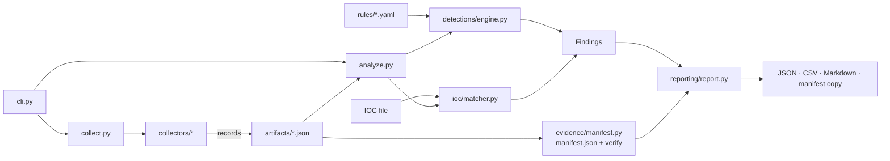

# Architecture

| Module | Responsibility |
|---|---|
| `cli.py` | argparse commands, exit codes, user-facing messages |
| `config.py` | defaults, strict validation, redaction patterns |
| `context.py` | `Context`: injectable filesystem root, command runner, clock, home. Makes collectors testable against a fake root |
| `models.py` | `CollectorResult`, `CollectionError`, `Finding`, exit-code constants |
| `platform_info.py` | distro/kernel/arch/init/container detection, `doctor` checks |
| `collectors/` | One module per artifact: `NAME`, `DESCRIPTION`, `PRIVILEGE_NOTE`, `plan()`, `collect()` |
| `parsers/` | Pure parsing (`/proc`, `ss`, unit files, crontab, auth logs). No I/O |
| `evidence/manifest.py` | artifact documents, manifest build/verify/load |
| `ioc/` | schema validation/normalisation, exact matcher |
| `detections/engine.py` | rule validation + evaluation (match/threshold/baseline) |
| `reporting/report.py` | report model + JSON/CSV/Markdown renderers |
| `utils/` | bounded subprocess runner, path safety/hashing, redaction, UTC time |

## Data flow

1. `collect` builds a `Context`, runs each selected collector (a crash becomes a `failed` artifact, never aborts others).
2. Each collector returns records + errors + sources + notes → `artifacts/<name>.json` (mode 0600).
3. `build_manifest` hashes every file → `manifest.json` (SHA-256 printed for off-box storage).
4. `scan`/`report` load artifacts, verify the manifest, evaluate rules and IOCs → findings → reports.

## Artifact record kinds

`processes` (process records) · `network` (`socket`, `interface`, `route`, `firewall`) · `persistence`
(`systemd_unit`, `systemd_dropin`, `systemd_enablement`, `unit_file_state`, `timer_state`, `cron_file`, `cron_entry`,
`cron_script`, `cron_spool_file`, `at_job`, `shell_startup`, `rc_local`, `init_script`, `sshd_config`,
`authorized_keys`, `kernel_module`) · `logs` (`auth_event`, `log_stats`) · `files` (`sensitive_file`,
`writable_dir_exec`) · `inventory` (`host`, `mount`, `session`).

## Extension points

- New collector: add a module with the five attributes and register it in `collectors/__init__.py` and `config.COLLECTOR_NAMES`.
- New rule: add YAML under `rules/` (see [configuration](configuration.md)). No code needed.
- New IOC field mapping: edit `ioc/matcher.py::FIELDS`.

## Design decisions

Records are plain JSON so evidence stays inspectable with standard tools; the fake-root `Context` lets CI test collectors
without root or a real host; rule files are data (no expression language) to remove code-execution risk.
