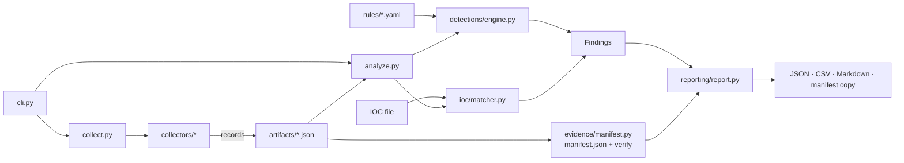

# Architecture

| Module | Responsibility |
|---|---|
| `cli.py` | argparse commands, exit codes, OS guard for live collection |
| `config.py` | defaults, strict validation (incl. log predicate), redaction patterns |
| `context.py` | `Context`: injectable filesystem root, command runner, clock, home. Lets tests run collectors on Linux/Windows against a fake Mac |
| `platform_info.py` | macOS version/arch support detection, `doctor` checks (no subprocesses) |
| `collectors/` | `inventory`, `processes`, `network`, `persistence`, `logs`, `files`: each with `NAME`, `DESCRIPTION`, `PRIVILEGE_NOTE`, `plan()`, `collect()` |
| `parsers/` | Pure parsers: `system.py` (ps, lsof -F, netstat, ifconfig, df, sysctl, codesign), `launchd.py` (plist), `unified_log.py` (ndjson), `cron.py` |
| `evidence/manifest.py` | artifact documents, manifest build/verify/load |
| `ioc/` | schema validation/normalisation, exact matcher |
| `detections/engine.py` | rule validation + evaluation |
| `reporting/report.py` | report model + JSON/CSV/Markdown renderers |
| `utils/` | bounded subprocess runner, path safety/hashing, redaction, UTC time |

## Data flow

1. `collect` builds a `Context` and runs each selected collector (a crash becomes a `failed` artifact; others continue).
2. Collectors return records + errors + sources + notes → `artifacts/<name>.json` (0600).
3. A manifest hashes every file → `manifest.json`; its SHA-256 is printed for off-box storage.
4. `scan`/`report` load artifacts, verify the manifest, evaluate rules and IOCs, then render reports.

## Record kinds

`processes` (process records) · `network` (`socket`, `interface`, `route`) · `persistence` (`launchd_plist`,
`launchd_unexpected_file`, `cron_entry`, `startup_item`, `emond_rule`, `periodic_script`, `login_item_artifact`,
`shell_startup`, `paths_d`) · `logs` (`auth_event`, `log_stats`) · `files` (`sensitive_file`, `writable_dir_exec`) ·
`inventory` (`host`, `session`, `volume`).

## Extension points

New collector: module with the five attributes, register in `collectors/__init__.py` and `config.COLLECTOR_NAMES`.
New rule: YAML under `rules/`. New IOC field mapping: `ioc/matcher.py::FIELDS`.

## Design decisions

Plain-JSON artifacts keep evidence inspectable; the fake-root `Context` makes collectors testable without a Mac; rules are
data (no expression language); `plistlib` is used for plists because it never instantiates arbitrary objects.
