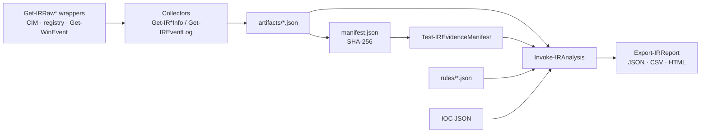

# Windows Incident Response Toolkit (`WinIRToolkit`)

A modular, **read-only** PowerShell toolkit for authorised Windows endpoint investigations: collect security-relevant host
evidence, review persistence, match IOCs, apply explainable detection rules, verify evidence integrity and produce reports (JSON,
CSV, safely escaped HTML). Part of the [incident-response-toolkit](../README.md) (Linux · macOS · Windows).

> **Not an EDR and not forensic acquisition.** Findings are leads, not verdicts, and a clean-looking result from an incomplete
> collection never means the host is clean. Read [security and limitations](docs/security-and-limitations.md).

## Features

| Area | What it does |
|---|---|
| Host inventory | OS/build, uptime (UTC + original local time/offset), AV products, Defender, firewall profiles, UAC |
| Processes | PID/PPID and parent names, owner, path, **redacted** command line, Authenticode signer, SHA-256 |
| Network | Listening ports and connections with owning process |
| Accounts & sessions | Local users, Administrators / Remote Desktop Users, logon sessions |
| Persistence | Services, scheduled tasks, Run/RunOnce, startup items, Winlogon, WMI event subscriptions |
| Events | Bounded Security / System / PowerShell / Sysmon windows, normalised to UTC |
| IOCs | Validated local JSON; sha256, process name, file path, IP, domain; exact matching |
| Detections | 33 declarative JSON rules (match / threshold / baseline), separate severity and confidence, false positives, ATT&CK |
| Evidence | Unique owner-only directories, SHA-256 manifest, tamper/missing/unexpected-file detection |
| Reports | `report.json`, `findings.csv`, `report.html` + manifest copy and SHA-256 |
| Profiles | `BasicTriage`, `AuthenticationInvestigation`, `PersistenceReview`, `FocusedIncident` |

Never done: killing processes, deleting evidence, disabling accounts, modifying registry or services, quarantining files,
executing discovered files/scripts/URLs/IOC content, transmitting anything off the host, or elevating privileges.

## Quick start

```powershell
git clone <repository-url>
cd incident-response-toolkit/windows
Import-Module ./src/Modules/WinIRToolkit/WinIRToolkit.psd1 -Force
./scripts/winir.ps1 -Command Doctor
./scripts/Invoke-Demo.ps1                      # fully synthetic end-to-end demo
./scripts/winir.ps1 -Command Collect -Profile BasicTriage -OutputPath ./evidence -DryRun   # preview a real collection
```

Full tutorial: [docs/walkthrough.md](docs/walkthrough.md). The synthetic workflow needs no administrator rights.

## Architecture



```
src/Modules/WinIRToolkit/   module manifest, root module, Public/ commands
src/Private/                helpers: paths, redaction, config, evidence, rules, IOC, reports, raw data sources
src/Configuration/          default.json, rules/*.json, schemas/report.schema.json
tests/Unit  tests/Integration  tests/Fixtures  tests/Shim     Pester tests, synthetic data sources, offline subset runner
sample-data/  examples/  scripts/  docs/                      synthetic evidence, IOCs, CLI/demo scripts, documentation
```

## Supported platforms

| Platform | Status |
|---|---|
| Windows 10/11, Windows Server 2016+; Windows PowerShell 5.1 and PowerShell 7 | **Targeted.** Live collection has **not been run on a Windows host** by the author of this repository (see [validation status](docs/security-and-limitations.md#validation-status-v010)); `windows-latest` CI runs the read-only integration tests. |
| PowerShell 7 on Linux/macOS | Analysis, reporting, verification, tests and the demo work; live collection is refused with an explanation. |

## Example output (synthetic, actual)

```
25 finding(s) from 33 rules
[HIGH    /high  ] WIR-AUTH-003 Audit log cleared
    audit_log_cleared by analyst at 2026-03-10T11:58:00Z.
    ref: artifacts/events.json#records[15]
```

## Limitations (summary)

Partial collection without elevation (Security log, other users' details), selective persistence coverage, no memory or disk
acquisition, user-mode view only, best-effort redaction, signing status is only context.

## Documentation

- [Getting started](docs/getting-started.md) · [Walkthrough](docs/walkthrough.md) · [User guide and command reference](docs/user-guide.md)
- [Configuration](docs/configuration.md) · [Troubleshooting](docs/troubleshooting.md)
- [Security and limitations](docs/security-and-limitations.md) · [Examples](docs/examples.md)
- [Contributing](CONTRIBUTING.md) · [Security policy](SECURITY.md) · [Code of conduct](CODE_OF_CONDUCT.md) · [Changelog](CHANGELOG.md)

## Project status

Version 0.1.0. Evidence handling (manifest, chain of custody, retention) is described in the
[user guide](docs/user-guide.md#reading-results) and [security and limitations](docs/security-and-limitations.md): a manifest stored
beside evidence is not independently tamper-proof; store its SHA-256 (or a signed copy) elsewhere.
