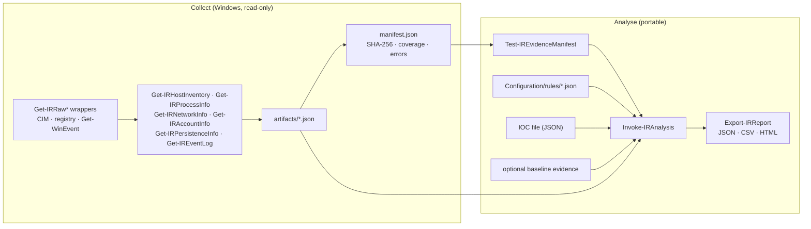
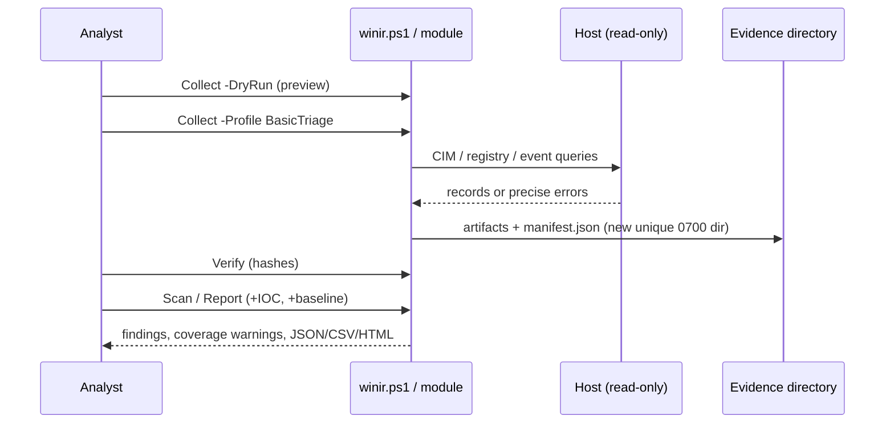

# User guide

## Architecture and workflow





## Command reference

All commands are exported by the `WinIRToolkit` module. `scripts/winir.ps1` wraps them with consistent exit codes.

| Command | Purpose | Key parameters | Permissions | Exit / error behaviour | Example |
|---|---|---|---|---|---|
| `Get-IRPlatformInfo` | Platform, PowerShell, elevation, available cmdlets | – | none | never throws | `Get-IRPlatformInfo \| Format-List` |
| `Test-IRPrerequisite` | Readiness checks (doctor): OS, PowerShell, privileges, cmdlets | – | none | returns `Status/Check/Detail`; wrapper exits 1 on any `FAIL` | `Test-IRPrerequisite \| Format-Table` |
| `Test-IRElevated` | Is the process elevated? | – | none | `$true`/`$false` | `Test-IRElevated` |
| `Get-IRConfiguration` | Load defaults, merge and validate a JSON config | `-Path` | none | throws on unknown keys / bad types | `Get-IRConfiguration -Path .\my.json` |
| `Get-IRCollectionPlan` | Dry-run plan of a profile | `-Profile -Collector -Config` | none | throws `IRUsage` for unknown profile/collector | `Get-IRCollectionPlan -Profile BasicTriage` |
| `Invoke-IRCollection` | Collect into a new unique directory + manifest | `-Profile -OutputPath -Collector -EventHours -ConfigPath -DryRun -SkipSignature -AllowNonWindows` | none required; elevation adds coverage | `IRUsage` for bad input / non-Windows; a failing collector becomes a `failed` artifact | `Invoke-IRCollection -Profile BasicTriage -OutputPath .\evidence` |
| `Get-IRHostInventory` | OS/build/uptime/time zone, AV, Defender, firewall, UAC | `-Config -Now` | none | returns result object with `Status/Errors` | `(Get-IRHostInventory).Records` |
| `Get-IRProcessInfo` | Processes, parent/child, redacted cmdline, owner, signer, SHA-256 | `-Config -SkipSignature -SkipHash` | none; elevation adds others' details | same | `(Get-IRProcessInfo).Records \| ? visibility -eq limited` |
| `Get-IRNetworkInfo` | Listening ports and connections with owner process | `-Config` | none | same | `(Get-IRNetworkInfo).Records \| ? state -eq Listen` |
| `Get-IRAccountInfo` | Local users, Administrators/RDP members, logon sessions | `-Config` | none for local data | same | `(Get-IRAccountInfo).Records` |
| `Get-IRPersistenceInfo` | Services, tasks, Run/RunOnce, startup, Winlogon, WMI subscriptions | `-Config -SkipSignature` | none; other users' tasks / WMI may need elevation | same | `(Get-IRPersistenceInfo).Records \| group kind` |
| `Get-IREventLog` | Bounded Security/System/PowerShell/Sysmon events | `-Config -Log -Hours -Now` | Security log needs elevation or *Event Log Readers* | throws only for invalid `-Hours`; per-channel errors recorded | `Get-IREventLog -Log Security -Hours 6` |
| `Import-IRIoc` | Load + validate IOC JSON | `-Path` | none | throws on any invalid entry | `Import-IRIoc .\examples\iocs.json` |
| `Find-IRIocMatch` | Exact IOC matching on loaded artifacts | `-Artifacts -Indicators -MatchSubdomains` | none | returns findings | see [examples](examples.md) |
| `Import-IRRule` | Load + validate JSON detection rules | `-Path` | none | throws on invalid/duplicate rules | `Import-IRRule \| Measure-Object` |
| `Test-IREvidenceManifest` | Verify evidence hashes (read-only) | `-Path` | none | returns `Ok/Modified/Missing/Unexpected/Unsafe/Error` | `Test-IREvidenceManifest .\sample-data\case-001` |
| `Protect-IREvidenceDirectory` | Create a manifest for imported/synthetic artifacts | `-Path` | write access to the directory | refuses to overwrite a manifest | `Protect-IREvidenceDirectory .\imported` |
| `Invoke-IRAnalysis` | Verify → rules → IOCs → baseline diff | `-Path -IocPath -BaselinePath -RulesPath -Config -AllowUnverified` | none | `IRUsage` (missing paths), `IRVerificationFailed`, `IRRuntime` | `Invoke-IRAnalysis -Path .\sample-data\case-001` |
| `Export-IRReport` | Write `report.json`, `findings.csv`, `report.html` (+ manifest copy) | `-Analysis -OutputPath -Format -EvidencePath -Config` | write access | never overwrites (throws) | `$a \| Export-IRReport -OutputPath .\reports\c1` |
| `Test-IRReportSchema` | Validate a report object against the documented schema | `-Report` | none | returns `Valid/Problems` | `Test-IRReportSchema $report` |

### `scripts/winir.ps1`

```powershell
.\scripts\winir.ps1 -Command Doctor|Info|Collect|Scan|Report|Verify|Seal [options]
```

| Exit code | Meaning |
|---|---|
| 0 | Success |
| 1 | Runtime error (invalid IOC/rules/config, malformed evidence, refusing to overwrite, `Doctor` FAIL) |
| 2 | Usage error (missing/invalid arguments or paths, unknown profile, live collection on non-Windows) |
| 3 | Evidence verification failed |
| 10 | `-Command Scan -FailOnFindings` and at least one finding |

## Collection profiles

| Profile | Collectors | Use |
|---|---|---|
| `BasicTriage` | inventory, processes, network, accounts, persistence, events | General first look |
| `AuthenticationInvestigation` | inventory, accounts, events (Security, System) | Suspected credential abuse |
| `PersistenceReview` | inventory, processes, persistence | Sweep for footholds |
| `FocusedIncident` | all, with Security, System, PowerShell and Sysmon channels | Active investigation |

Custom profiles can be added in a [configuration file](configuration.md). `-DryRun` shows every planned operation and its
permission needs; nothing is collected or written.

## Reading results

- **Confirmed observations**: facts read from the host. **Heuristic findings**: rule matches; *severity* is impact if true,
  *confidence* is how likely the match is meaningful. **IOC matches**: exact equality with a supplied indicator. **Collection errors**
  and **areas not assessed**: everything that could not be read.
- A finding is a lead, never a verdict. **Never treat an empty result as "clean" when `coverage` shows `partial`, `failed`, or `skipped`
  artifacts, or when the Security log was not readable.**
- Each finding has `evidence_ref` (for example `artifacts/persistence.json#records[2]`): open that file and index to see the raw record.

## Permissions and elevation

The toolkit never elevates itself. Without elevation expect: Security log access denied (unless you are in *Event Log Readers*),
missing owners/command lines for other users' processes, some WMI namespaces and other users' scheduled tasks unreadable. Each
shows up as a `permission_denied` entry in the manifest and report. You decide whether to re-run specific collectors from an
elevated session.
