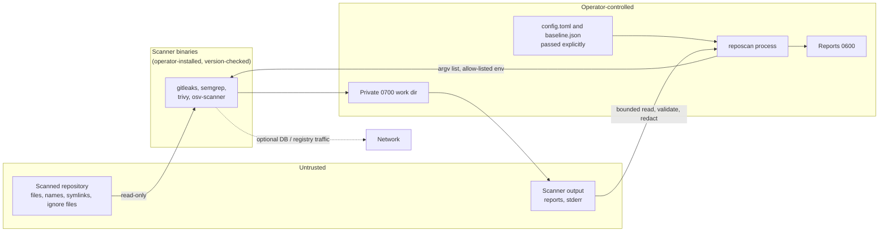

# Threat model

Method: assets → actors → trust boundaries → threats (STRIDE-flavoured) → mitigations → residual risk.

## Assets

1. Secrets present in scanned repositories (and the CI environment's own credentials).
2. Integrity of the verdict: "this change is acceptable" must not be forgeable.
3. Integrity and confidentiality of reports, baselines and configs.
4. The CI runner / developer machine that executes the scan.
5. Source code and findings (confidentiality).

## Actors

| Actor | Capability |
|---|---|
| **Malicious contributor** | Controls every byte of a pull request: source, file names, symlinks, ignore files, inline comments, lockfiles, baselines/configs inside the repo, git history. |
| Compromised or buggy scanner | Emits hostile or malformed output, hangs, floods output, crashes. |
| Network attacker / unavailable service | Blocks or tampers with DB and registry downloads. |
| Careless operator | Misconfigures thresholds, accepts findings without review, leaks reports. |
| Insider with baseline-write access | Hides findings via baseline or suppressions. |

## Trust boundaries

## Threats and mitigations

| # | Threat | Mitigation | Residual risk |
|---|---|---|---|
| T1 | Repository hides findings via ignore files / inline allow comments (`gitleaks:allow`, `nosemgrep`, `trivy:ignore`) / repo config | All repo-controlled channels disabled or fail-closed ([list](security-and-limitations.md#repository-controlled-suppression-is-neutralised)); config and baseline never auto-discovered | Scanner features added in future versions that read repository-supplied suppressions (re-verify on upgrade) |
| T2 | Command / argument injection through paths, names, image refs, config values | `shell=False`, argv lists, absolute resolved paths, image-ref allow-pattern, NUL rejection, env allow-list | A scanner bug that mis-handles a hostile name |
| T3 | Path traversal / symlink escape to read or overwrite files | Resolved targets; `O_NOFOLLOW`; reads confined to the root; atomic writes refusing symlinks | Races on writable output dirs owned by others — use a private directory |
| T4 | Secret disclosure via logs, console, reports, artifacts, CI summaries | Source-level redaction, shape-based redaction at every boundary, redacting log filter (incl. exceptions), `0600` reports, evidence withholding, no raw stderr passthrough | Unknown credential formats in non-secret scanner fields |
| T5 | Report injection: HTML/JS, Markdown links/mentions, GitHub workflow commands, terminal escapes | Escaping/encoding per sink; CSP; control-character stripping; annotation cap | Viewer-specific rendering bugs |
| T6 | Hostile or malformed scanner output (huge, deeply nested, wrong types) | Size caps (process and report file), recursion errors caught, strict shape checks → `malformed_output`, no `eval`/pickle | Memory use up to the cap (64 MiB default) |
| T7 | Scanner failure treated as success (false assurance) | Non-zero unexpected exit, missing report, timeout, version mismatch, OSV exit 127/128 → exit 3; empty results with errors are not clean | Scanner reports success after silently skipping files |
| T8 | Resource exhaustion (hangs, forks, output floods) | Timeouts, process-group kill, output caps, bounded file walk | CPU/RAM used by the scanner itself before timeout |
| T9 | Execution of repository code | No build or install steps; static analysis only; cwd outside the repo; refuse scanner binaries located inside the target | `--history` runs git over repository data (documented) |
| T10 | Exfiltration of code or findings | No network code in reposcan; telemetry off; registry rules opt-in; OSV `local-db` option; network-less namespace recipe (tested) | Opt-in features that contact services; compromised scanner (use isolation) |
| T11 | Baseline / suppression abuse | Owner + reason mandatory, expiry rules, visibility in reports, review/stale tooling, CODEOWNERS and base-branch baseline guidance | Social engineering of reviewers |
| T12 | Tampered or stale vulnerability data | Operator-controlled sources; offline mode fails on cold cache | Registry compromise or stale cache not detected by reposcan |
| T13 | Supply chain of reposcan and CI | Locked dependencies, `pip-audit`, SHA-pinned actions, `permissions: contents: read`, protected `release` environment, `persist-credentials: false` | Pins resolved without direct GitHub access (see README) |
| T14 | CI privilege escalation via untrusted PRs | `pull_request` (not `_target`), no secrets in scan jobs, SARIF upload skipped for forks | Misconfiguration downstream of the examples |
| T15 | Crash masquerading as a policy result | Dedicated exit code 4 for internal errors; 3 for scanners; 1 only for completed policy failures | — |

## Out of scope

Vulnerabilities in the scanners themselves, the host OS, Python, or the CI platform; denial of service by an
authorised operator; physical access.
