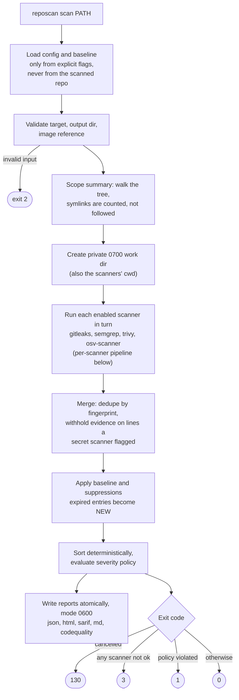
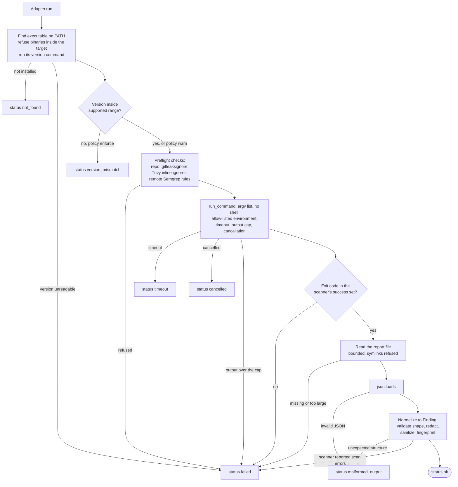
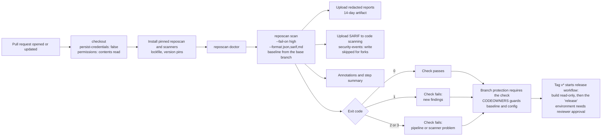

# User guide

- [How a scan works](#how-a-scan-works)
- [Command reference](#command-reference)
- [Scanners](#scanners) · [OSV-Scanner modes](#osv-scanner-modes) · [Upgrading scanners](#upgrading-scanners)
- [The unified finding](#the-unified-finding)
- [Reports](#reports)
- [Baselines and suppressions](#baselines-and-suppressions)
- [Severity policy and exit codes](#severity-policy-and-exit-codes)
- [Offline use and database updates](#offline-use-and-database-updates)
- [Container images and git history](#container-images-and-git-history)
- [CI integration](#ci-integration)

## How a scan works

The diagram is the real control flow of `reposcan scan` (`orchestrator.run_scan`, `adapters/base.py`,
`runner.py`). Every non-`ok` branch is recorded in the report and leads to exit code 3.

The per-scanner pipeline (`adapters/base.py` and `runner.py`). Every branch that is not `ok` is recorded in
the report; a run with any such branch exits 3 even if it found nothing.

Scanners run one after another (not in parallel) so that results, logs and failures are deterministic.

## Command reference

Global: `reposcan --help`, `reposcan COMMAND --help`. Exit codes are listed
[below](#severity-policy-and-exit-codes).

| Command | Purpose | Key options |
|---|---|---|
| `reposcan version` | Print the version. | |
| `reposcan doctor` | Discover scanners and check versions. Exit 3 if any checked scanner is not `ok`. | `--config FILE`, `--all` (include optional scanners), `--json`, `-v` |
| `reposcan update-db` | Refresh Trivy's vulnerability DB. The only command whose purpose is network access. | `--config FILE`, `-v` |
| `reposcan scan [PATH]` | Scan `PATH` (default `.`), write reports, enforce policy. | `--config FILE`, `--baseline FILE`, `--scanners a,b`, `--fail-on LEVEL`, `--output-dir DIR` (default `reposcan-output`), `--format json,html,sarif,md,codequality`, `--offline/--online`, `--timeout SEC`, `--history`, `--image REF`, `--allow-repo-ignore-files`, `--github-annotations`, `--github-summary`, `-v` |
| `reposcan baseline create [PATH]` | Scan and accept the current **new** findings into a baseline. | `--owner` (required), `--reason` (required), `--expires YYYY-MM-DD`, `--baseline-file FILE`, `--from-report FILE`, `--config`, `--scanners`, `--offline/--online`, `--allow-repo-ignore-files` |
| `reposcan baseline review [FILE]` | List entries with owner, reason, expiry, health (`ok`, `expires-soon`, `no-expiry`, `EXPIRED`, `STALE`). | `--report FILE` (enables STALE), `--strict` (exit 1 on EXPIRED/STALE/no-expiry), `--json` |
| `reposcan report show --input FILE` | Print findings from a JSON result. | `--status new\|baseline\|suppressed`, `--scanner NAME` |
| `reposcan report render --input FILE` | Re-render reports from a JSON result (schema-validated). | `--format`, `--output-dir` |
| `reposcan config validate FILE` | Validate a TOML config. | |
| `python -m reposcan …` | Same as `reposcan …`. | |

Helper scripts (run from the project directory):

| Script | Purpose |
|---|---|
| `scripts/demo.sh [--with-trivy]` | Clean / findings / scanner-failure demonstration with exit-code checks. |
| `scripts/walkthrough.sh [--with-trivy]` | Runs every walkthrough command. |
| `scripts/cleanup.sh` | Removes generated files (`demo-output/`, `walkthrough-output/`, caches). |
| `scripts/validate_sarif.py FILE` | Validate SARIF against the offline OASIS 2.1.0 schema. |
| `scripts/generate_schema.py [--check]` | (Re)generate / verify `docs/report-schema.json`. |
| `scripts/check_workflows.py DIR` | Verify SHA-pinned actions, explicit `permissions`, no `pull_request_target`, no expression injection. |
| `scripts/capture_fixtures.py` | Re-capture sanitised real scanner output into `tests/fixtures/scanner-output/`. |

## Scanners

| Scanner | Covers | Invocation (abridged; all argv lists, never shell strings) | Success exit codes | Supported / tested |
|---|---|---|---|---|
| **Gitleaks** | Secrets | `gitleaks dir\|git --config <bundled> --redact=100 --ignore-gitleaks-allow --exit-code 10 --gitleaks-ignore-path <empty dir> -f json -r <report> <target>` | 0 clean, 10 leaks (1 is Gitleaks' own error) | `>=8.19,<9` / 8.30.1 |
| **Semgrep** | SAST | `semgrep scan --config <copied local rules> --json-output <report> --quiet --disable-version-check --no-git-ignore --x-ignore-semgrepignore-files --disable-nosem --metrics off <target>` | 0 | `>=1.70,<2` / 1.181.0 |
| **Trivy** | Dependencies, IaC / misconfiguration, optional secrets, container images | `trivy fs\|image --format json --output <report> --scanners vuln,misconfig --ignorefile <empty> --exit-code 0 --disable-telemetry …` | 0 | `>=0.50,<1` / 0.76.0 |
| **OSV-Scanner** (optional) | Dependencies (extra coverage) | `osv-scanner scan source --recursive --no-ignore --allow-no-lockfiles --no-resolve --config <empty> -f json --output-file <report> <target>` | 0 clean, 1 vulnerabilities (127 = error, e.g. API unreachable; 128 = no packages) | `>=2.0,<3` / 2.7.0 |

Notes verified against the real tools:

- **Gitleaks** always loads a `.gitleaksignore` found in the scanned directory. reposcan therefore refuses
  to run if it exists (exit 3 with an explanatory error) unless you pass `--allow-repo-ignore-files`, in
  which case a prominent warning is recorded. It also supplies its own config (a repository's
  `.gitleaks.toml` is ignored) and disables inline `gitleaks:allow` comments.
- **Semgrep** honours `.semgrepignore`, `.gitignore` and trailing `# nosemgrep` comments by default;
  reposcan turns all three off so a pull request cannot hide its own findings. `semgrep --version` blocks ~100 s without network unless version
  checking is disabled, which reposcan does through `SEMGREP_ENABLE_VERSION_CHECK=0`.
  The open-source CLI returns `"lines": "requires login"`, so reposcan reads the matched line itself.
- **Trivy** ignores `.trivyignore` because `--ignorefile` points at an empty file and the working directory
  is private. A `trivy.yaml` in the scanned repo is never read. Trivy does honour inline
  `#trivy:ignore:…`/`#tfsec:ignore:…` comments in IaC files and cannot be told not to, so reposcan
  refuses (exit 3) when it finds one unless you pass `--allow-repo-ignore-files`.
- **OSV-Scanner** exits 127 **and still writes an empty-but-valid `{"results": []}`** when it cannot reach
  its API (observed). reposcan classifies 127/128 as failures, so this can never look clean.

Licences (verified 2026-10-16): Gitleaks MIT, Trivy Apache-2.0, OSV-Scanner Apache-2.0, Semgrep CLI
LGPL-2.1-or-later. reposcan does not bundle or redistribute them. Registry rules fetched from Semgrep have
their own licence; reposcan's bundled rules are MIT.

### OSV-Scanner modes

Disabled by default (Trivy already covers dependencies). Enable with
`[scanners.osv] enabled = true`.

| `mode` | Network | Privacy |
|---|---|---|
| `"api"` (default) | Queries `api.osv.dev` | Sends package names and versions (not source) to Google's OSV service. |
| `"local-db"` | Downloads ecosystem archives from `osv-vulnerabilities.storage.googleapis.com` into the OSV cache (≈35 MB for PyPI, observed), then matches locally | Nothing about your packages leaves the machine. With `--offline` no download occurs and a cold cache fails with exit 3. |

`allow_network_resolution = true` additionally lets OSV-Scanner resolve transitive dependencies from
manifests through package registries; it is off by default (`--no-resolve`).

### Upgrading scanners

1. Install the new scanner version side by side (see [Getting started](getting-started.md#2-install-the-scanners)).
2. `reposcan doctor`: it reports `version_mismatch` while the version is outside the adapter's range.
   (`[scan] version_policy = "warn"` downgrades this to a warning for experimentation only.)
3. `pytest -m integration` (add `REPOSCAN_ITEST_NETWORK=1` for Trivy/OSV) and `python scripts/capture_fixtures.py`;
   review `git diff tests/fixtures/scanner-output/` for schema changes.
4. Update the adapter's `supported` and `tested` attributes in `src/reposcan/adapters/<scanner>.py`, the
   tables in this guide, `README.md` and `LICENSE`, then run the full checks from `CONTRIBUTING.md`.
5. Pin the new version in your CI (`semgrep==…`, `go install …@vX.Y.Z`, container digests).

## The unified finding

Every scanner's output is validated and mapped to one schema (`docs/report-schema.json`):

| Field | Meaning |
|---|---|
| `fingerprint` | 32-hex identity: hash of scanner, rule, file and normalised evidence/package, plus an occurrence index. **Not** the line number. |
| `scanner`, `kind` | `gitleaks`/`semgrep`/`trivy`/`osv-scanner`; `secret`/`sast`/`dependency`/`misconfiguration`. |
| `rule_id`, `title` | Scanner rule or advisory id, e.g. `generic-api-key`, `CVE-2019-10906`. |
| `severity`, `original_severity` | Unified `critical/high/medium/low/info`; the scanner's own label. Unknown labels map to `scan.unknown_severity` (default `medium`). |
| `file`, `line`, `end_line`, `artifact` | Path relative to the scan root; `artifact` is used for container images. Paths outside the root are dropped, not guessed. |
| `dependency` | `name`, `installed_version`, `fixed_version`, `ecosystem`. |
| `cve`, `cwe`, `references` | Identifiers and (at most five) reference URLs. |
| `evidence` | The matched snippet, **redacted**, whitespace-collapsed, ≤240 characters. |
| `remediation` | Concrete next step. |
| `status`, `status_detail`, `suppression_expired` | `new`, `baseline` or `suppressed`; owner/reason text; true when an acceptance expired. |

Secret values are never stored. Gitleaks is invoked with `--redact=100`; text is also redacted by shape
(AWS keys, GitHub/GitLab/Slack/Stripe/Google tokens, JWTs, private-key blocks, `key = value` assignments,
URL credentials, bearer tokens) before it can reach a log, console line or report. If a secret scanner
flagged a line, other scanners' evidence for that line is replaced with a placeholder.

## Reports

See the format table in the [walkthrough](walkthrough.md#4-generating-json-html-and-sarif-reports).
JSON/SARIF/Markdown are deterministic for equal input (sorted, `sort_keys`); set `SOURCE_DATE_EPOCH` to
make timestamps reproducible. The JSON report includes: tool and scanner versions, supported ranges, the
scrubbed command lines (`<target>`, `<workdir>` placeholders instead of local paths), exit codes, durations,
the scope summary (file count, bytes, top extensions, symlinks skipped, whether history was scanned), the
policy outcome, warnings and the final exit code with a reason.

SARIF details: one run per scanner (`automationDetails.id = reposcan/<scanner>`); `level` error for
critical/high, warning for medium, note otherwise; `security-severity` property for GitHub; baselined and
suppressed findings carry `suppressions[]` with the owner/reason text and `baselineState: unchanged`;
findings with no file (container images) use the location `.` plus a logical location.

## Baselines and suppressions

Two mechanisms, same principle: **owner + reason + optional expiry, always visible, never silent.**

1. **Baseline file** (`reposcan-baseline.json`): created from a scan with `baseline create`; matched by
   fingerprint. Entries carry owner, reason, creation date, optional expiry, and the finding's rule, file,
   severity and title.
2. **`[[suppressions]]` in the config**: by `fingerprint`, or by `rule_id` (+ optional `scanner` and a
   `path` glob). Same owner/reason/expiry fields.

Behaviour: an accepted finding gets `status = baseline|suppressed` and stays in every report; an **expired**
entry no longer applies and the finding is `new` with `suppression_expired = true`; stale entries and unused
suppressions produce warnings. Policy: `require_expiry_at_or_above` (default `critical`) forces an expiry for
those severities; `max_accept_days` (default 365) caps how far out an expiry may be. `baseline create` refuses
to write from an incomplete scan.

Review it like code: commit the baseline, protect it with CODEOWNERS, and in CI prefer the baseline from the
**base branch** so a pull request cannot add its own exceptions ([example](examples.md#baseline-from-the-base-branch)).

## Severity policy and exit codes

| Setting | Effect |
|---|---|
| `policy.fail_on` / `--fail-on` | Lowest severity that fails: `critical`, `high` (default), `medium`, `low`, `info`, or `none` (report-only). |
| `policy.fail_on_baseline` | Also count accepted baseline findings (default false). |

| Exit | Meaning |
|---|---|
| 0 | Completed; policy satisfied |
| 1 | Completed; new findings at/above the threshold |
| 2 | Configuration or usage error |
| 3 | Scanner problem: not installed, version out of range, timeout, crash/unexpected exit, missing or malformed output, refused by a safety check |
| 4 | Internal error (a bug) |
| 130 | Cancelled by SIGINT/SIGTERM |

Precedence: 130 > 2 > 4 > 3 > 1 > 0. Partial findings from healthy scanners are still reported when
another scanner fails.

## Offline use and database updates

- **Gitleaks and Semgrep** need no network; with `--offline` nothing changes for them.
- **Trivy** downloads its vulnerability DB (≈1.6 GB on disk, observed) on first use and refreshes it when
  stale. Warm the cache while online with `reposcan update-db`; then scan with `--offline`, which adds
  `--skip-db-update --skip-java-db-update --offline-scan --skip-check-update`. With a **cold** cache an
  offline scan fails (exit 3): *observed and covered by an integration test*, never a silent pass. Keep the
  cache fresh: an offline scan against a months-old DB reports yesterday's knowledge as if it were today's.
  Set `TRIVY_CACHE_DIR` via `[scan] env_passthrough` to share a cache between runs.
- **OSV-Scanner**: see the modes above.
- The first online Trivy run also fetches policy bundles for IaC checks; `--offline` uses the embedded set.

## Container images and git history

- `--image REF` makes Trivy scan the image **instead of** the filesystem (registry access; Trivy finds registry
  credentials through `HOME`, e.g. Docker's config file, which reposcan passes through; other variables
  such as `TRIVY_USERNAME`/`TRIVY_PASSWORD` are **not** forwarded unless you list them in `env_passthrough`). Image refs are validated against a conservative pattern. Gitleaks and Semgrep still
  scan `PATH`.
- `--history` makes Gitleaks scan git **history** (`gitleaks git`) **instead of** the working tree. It runs
  `git` against repository data, which a malicious repository can influence (for example through textconv
  drivers in `.gitattributes`). A warning is recorded; scan untrusted history only in a sandbox. Per-commit
  findings are reported with the commit hash in the remediation text.

## CI integration

Ready-made definitions:

- GitHub Actions: `.github/workflows/ci.yml` (lint, types, tests, integration, dependency audit, workflow
  hygiene), `security-scan.yml` (self-scan with SARIF upload), `release.yml` (protected release). Because
  GitHub only runs workflows at the repository root, this repository also carries a wrapper at
  `../.github/workflows/reposcan-ci.yml`.
- GitLab CI: `examples/gitlab/.gitlab-ci.yml` (digest-pinned image, Code Quality widget, artifacts).
- Practices baked in: SHA-pinned actions (checked by `scripts/check_workflows.py`; SHAs resolved on
  2026-10-16 from the Go module proxy's recorded tag commits, **please verify them against GitHub**),
  `permissions: contents: read` by default, `persist-credentials: false`, `pull_request` (never
  `pull_request_target`), no secrets in scan jobs, reports written outside the source tree, locked
  dependencies (`uv.lock`), `pip-audit` on the lock, secret scanning of the project itself, and a protected
  `release` environment.
- The workflows were validated with `actionlint` v1.7.12 but **have not been executed on GitHub or GitLab**.

Keep CI logs clean: do not add `-v` to production jobs unless needed. Debug logs pass through the same
redaction filter, but fewer logs means fewer places for surprises.
