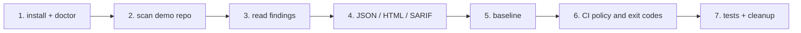

# Walkthrough

A hands-on tour using only the bundled fixtures. Every command below is run from the project directory
(`repo-security-scanner/`) with the virtual environment active. The same commands are scripted in
`scripts/walkthrough.sh`, which is how the output below was captured.

**How to read the output blocks.** *Observed* = captured on 2026-10-16 on Linux x86-64 with reposcan 0.1.0,
Gitleaks 8.30.1, Semgrep 1.181.0, Trivy 0.76.0, OSV-Scanner 2.7.0. Absolute path prefixes are shortened to
`…/`. Timings and random temporary-directory names are omitted. Dependency counts depend on the advisory
database of the day.

Contents: [1 Install and verify](#1-installation-and-scanner-version-verification) ·
[2 Scan the demo repo](#2-scan-the-bundled-demonstration-repository) ·
[3 Interpret findings](#3-interpreting-secret-static-analysis-and-dependency-findings) ·
[4 Reports](#4-generating-json-html-and-sarif-reports) ·
[5 Baselines](#5-creating-and-reviewing-a-baseline) ·
[6 CI policy](#6-enforcing-a-severity-policy-in-ci) ·
[7 Tests and cleanup](#7-running-tests-and-cleaning-up) ·
[Exercises](#exercises)



## 1. Installation and scanner version verification

```bash
cd repo-security-scanner
python3 -m venv .venv && . .venv/bin/activate
pip install -e ".[dev]"
reposcan version
reposcan doctor
```

Observed:

```text
reposcan 0.1.0
  gitleaks     ok                found=8.30.1    supported=>=8.19,<9  tested=8.30.1
  semgrep      ok                found=1.181.0   supported=>=1.70,<2  tested=1.181.0
  trivy        ok                found=0.76.0    supported=>=0.50,<1  tested=0.76.0
```

`found` is what reposcan executed (`gitleaks version`, `semgrep --version`, …); `supported` is the range the
adapter has been written against; `tested` is the newest version the project's tests ran with. Install steps
for the scanners are in [Getting started](getting-started.md#2-install-the-scanners).

## 2. Scan the bundled demonstration repository

`sample-data/demo-repo/` is a five-file project that is vulnerable on purpose (see its `README.md`):
`app/server.py` has SQL injection, command injection, weak hashing and `eval`; `app/settings.py` holds
**synthetic** credentials; `requirements.txt` pins old libraries; `infra/Dockerfile` runs as root.

The *default path* uses only the two scanners that need no network:

```bash
reposcan scan sample-data/demo-repo --scanners gitleaks,semgrep --output-dir walkthrough-output/exercise1
echo "exit code: $?"
```

Observed:

```text
reposcan 0.1.0  target=demo-repo  files=5
  gitleaks     ok                v8.30.1    findings=2
  semgrep      ok                v1.181.0   findings=4
findings: critical=0 high=5 medium=1 low=0 info=0  |  new=6 baseline=0 suppressed=0
wrote …/walkthrough-output/exercise1/reposcan-report.json
wrote …/walkthrough-output/exercise1/reposcan-report.html
wrote …/walkthrough-output/exercise1/reposcan.sarif
wrote …/walkthrough-output/exercise1/reposcan-summary.md
result: policy failed: 5 high finding(s) at or above the 'high' threshold (exit 1)
exit code: 1
```

Exit code `1` is a **policy failure** (new findings at or above `high`). It is not a scanner error: both
scanners show `ok`.

## 3. Interpreting secret, static-analysis and dependency findings

```bash
reposcan report show --input walkthrough-output/exercise1/reposcan-report.json
```

Observed:

```text
6 finding(s)
HIGH     new        semgrep     reposcan.python.sql-string-concat  app/server.py:13
           evidence: return conn.execute(query).fetchall()
HIGH     new        semgrep     reposcan.python.subprocess-shell-true  app/server.py:18
           evidence: return subprocess.call("ping -c 1 " + host, shell=True)
HIGH     new        semgrep     reposcan.python.eval-call  app/server.py:28
           evidence: return eval(expression)
HIGH     new        gitleaks    reposcan-synthetic-token  app/settings.py:4
           evidence: REDACTED
HIGH     new        gitleaks    generic-api-key  app/settings.py:7
           evidence: internal_api_key = "REDACTED"
MEDIUM   new        semgrep     reposcan.python.weak-hash  app/server.py:23
           evidence: return hashlib.md5(data).hexdigest()
```

### 3a. Secret finding (Gitleaks)

Observed excerpt of `reposcan-report.json` (empty/default fields removed):

```json
{
  "scanner": "gitleaks", "kind": "secret", "rule_id": "reposcan-synthetic-token",
  "title": "Synthetic demo token (fixtures only; matches no real service)",
  "severity": "high", "file": "app/settings.py", "line": 4,
  "cwe": ["CWE-798"], "evidence": "REDACTED",
  "fingerprint": "fa0b4efc69fad0c818b42d408cc07a3d", "status": "new",
  "remediation": "Revoke and rotate this credential, remove it from the repository history, and load it from a secret manager or CI secret store instead."
}
```

- **What it means:** a string matching a credential rule sits in source. Anyone who can read the repository
  (including past clones) can read it. Deleting the line does not un-leak it.
- **Evidence is redacted twice**: Gitleaks is run with `--redact=100`, and reposcan masks credential-shaped
  text again before writing anything. You learn *where* and *which rule*, never the value.
- **Second finding, `generic-api-key` (line 7):** a high-entropy value assigned to a key-like name. Gitleaks
  keeps the variable name in the match (`internal_api_key = "REDACTED"`), which helps triage.
- **What to do:** revoke/rotate first, then remove from history if needed, then load it from a secret store.
  The demo values are synthetic, so there is nothing to rotate.

### 3b. Static-analysis finding (Semgrep)

```json
{
  "scanner": "semgrep", "kind": "sast", "rule_id": "reposcan.python.sql-string-concat",
  "severity": "high", "original_severity": "ERROR", "file": "app/server.py", "line": 13,
  "cwe": ["CWE-89"], "evidence": "return conn.execute(query).fetchall()", "status": "new",
  "fingerprint": "08403bbc85b9278c8691ecbb643c4107"
}
```

- `original_severity` keeps the scanner's own label (`ERROR`); `severity` is the unified value
  (`ERROR`→high, `WARNING`→medium, `INFO`→low).
- The rule matched `conn.execute(query)` because `query` was built with `+` from user input on line 12.
  The evidence is the matched line (Semgrep's open-source CLI does not return source lines, so reposcan
  reads that single line itself, from inside the scan root only, and never follows symlinks out of it).
- **What to do:** use a parameterised query: `conn.execute("… WHERE name = ?", (username,))`; compare with
  `sample-data/clean-repo/main.py`.
- Rules shipped with reposcan live in `src/reposcan/data/semgrep-rules.yml` and are original work.

### 3c. Dependency finding (Trivy) — needs the Trivy vulnerability DB

This part needs Trivy and its database (network on first use, ≈1.6 GB observed). Skip it if you do not
have Trivy.

```bash
reposcan scan sample-data/demo-repo --scanners trivy --output-dir walkthrough-output/trivy
reposcan report show --input walkthrough-output/trivy/reposcan-report.json --scanner trivy
```

Observed (abridged; 16 findings: 13 vulnerabilities in `requirements.txt`, 3 Dockerfile checks):

```text
CRITICAL new        trivy       CVE-2020-14343  requirements.txt PyYAML 5.3
CRITICAL new        trivy       CVE-2020-1747  requirements.txt PyYAML 5.3
HIGH     new        trivy       DS-0002  infra/Dockerfile
HIGH     new        trivy       CVE-2018-18074  requirements.txt requests 2.19.1
HIGH     new        trivy       CVE-2019-10906  requirements.txt Jinja2 2.10
MEDIUM   new        trivy       CVE-2020-28493  requirements.txt Jinja2 2.10
…
LOW      new        trivy       DS-0005  infra/Dockerfile:2
           evidence: ADD . /app
```

One finding in full:

```json
{
  "scanner": "trivy", "kind": "dependency", "rule_id": "CVE-2019-10906",
  "title": "python-jinja2: str.format_map allows sandbox escape", "severity": "high",
  "file": "requirements.txt",
  "dependency": {"name": "Jinja2", "installed_version": "2.10", "fixed_version": "2.10.1", "ecosystem": "pip"},
  "cve": ["CVE-2019-10906"], "status": "new",
  "remediation": "Upgrade Jinja2 to 2.10.1 (installed: 2.10)."
}
```

- **Dependency findings point at the manifest** (`file`), name the package, the installed and fixed
  versions, and CVE ids; there is no source line.
- **Misconfiguration findings** (`DS-0002` = container runs as root) come from Trivy's built-in IaC checks.
- Severity is the scanner's, mapped to the unified scale. `unknown` severities use
  `scan.unknown_severity` (default `medium`) so they are never silently ignored.
- OSV-Scanner reports the same advisories; with both enabled you will see duplicates (one per scanner).

## 4. Generating JSON, HTML and SARIF reports

```bash
reposcan scan sample-data/demo-repo --scanners gitleaks,semgrep \
  --format json,html,sarif --output-dir walkthrough-output/exercise2
python scripts/validate_sarif.py walkthrough-output/exercise2/reposcan.sarif
ls -l walkthrough-output/exercise2
```

Observed:

```text
valid SARIF 2.1.0: 2 run(s), 6 result(s)
-rw------- 1 root root  6141 …  reposcan-report.html
-rw------- 1 root root  7854 …  reposcan-report.json
-rw------- 1 root root 11044 …  reposcan.sarif
```

| Format (`--format`) | File | Use |
|---|---|---|
| `json` | `reposcan-report.json` | The complete, schema-versioned record ([schema](report-schema.json)); input for `report show/render` and `baseline`. |
| `html` | `reposcan-report.html` | Human review. Fully escaped, no scripts, no external resources, strict CSP. |
| `sarif` | `reposcan.sarif` | SARIF 2.1.0, one run per scanner; upload to GitHub code scanning. |
| `md` | `reposcan-summary.md` | Pull-request summary (also appended to `$GITHUB_STEP_SUMMARY` with `--github-summary`). |
| `codequality` | `gl-code-quality-report.json` | GitLab merge-request widget (new findings only). |

Reports are written with mode `0600`, atomically, and never through a symbolic link. Open the HTML report in
a browser; the SARIF has `partialFingerprints` so code scanning can track alerts across commits.

## 5. Creating and reviewing a baseline

A baseline records findings you have **knowingly accepted**, each with an owner, a reason and (for high and
critical severity, required) an expiry. Work on a copy so the fixture stays pristine:

```bash
cp -r sample-data/demo-repo walkthrough-output/work-repo
EXPIRY="$(python3 -c 'import datetime;print(datetime.date.today()+datetime.timedelta(days=90))')"
reposcan baseline create walkthrough-output/work-repo --scanners gitleaks,semgrep \
  --owner team-appsec --reason "Legacy demo code, tracked in TICKET-1" \
  --expires "$EXPIRY" --baseline-file walkthrough-output/baseline.json
reposcan baseline review walkthrough-output/baseline.json
```

Observed (the expiry date is 90 days after the run):

```text
baseline: 6 finding(s) accepted, 6 total entries
  + [high] semgrep:reposcan.python.sql-string-concat app/server.py
  …
wrote walkthrough-output/baseline.json
review the file, then commit it under CODEOWNERS protection

6 baseline entries
  b6386b58f8e6 high     reposcan.python.eval-call          app/server.py   owner=team-appsec expires=2027-01-14 [ok] Legacy demo code, tracked in TICKET-1
  …
```

Then scan with the baseline, introduce a **new** vulnerability, and scan again:

```bash
reposcan scan walkthrough-output/work-repo --scanners gitleaks,semgrep \
  --baseline walkthrough-output/baseline.json --output-dir walkthrough-output/exercise3-pass
# append a new eval() to app/server.py (scripts/walkthrough.sh does this), then:
reposcan scan walkthrough-output/work-repo --scanners gitleaks,semgrep \
  --baseline walkthrough-output/baseline.json --output-dir walkthrough-output/exercise3-fail
```

Observed:

```text
findings: critical=0 high=5 medium=1 low=0 info=0  |  new=0 baseline=6 suppressed=0
result: scan complete, policy satisfied (exit 0)

findings: critical=0 high=6 medium=1 low=0 info=0  |  new=1 baseline=6 suppressed=0
result: policy failed: 1 high finding(s) at or above the 'high' threshold (exit 1)
```

Key properties:

- The baselined findings are still **listed** (status `baseline`, with owner and reason) in every report.
- The new `eval(text)` on line 33 failed the build although the old `eval(expression)` is baselined: finding
  identity is the rule, the file and the (normalised) matching code, **not the line number**, so moving
  code does not resurrect accepted findings, and a *new* instance is never swallowed by an old one.
- When an entry's `expires` date passes, the finding becomes **new** again (`suppression_expired: true`).
  `reposcan baseline review --strict` exits `1` on expired, stale or never-expiring entries. `STALE` means
  the finding no longer appears; delete the entry. Pass `--report` to enable stale detection.
- Baseline risks are covered in [Security and limitations](security-and-limitations.md#baseline-risks).

## 6. Enforcing a severity policy in CI

`--fail-on` (or `[policy] fail_on`) sets the lowest severity that fails the build. Only **new** findings count
by default.

```bash
reposcan scan sample-data/demo-repo --scanners gitleaks,semgrep --fail-on critical --output-dir walkthrough-output/exercise4-critical  # exit 0
reposcan scan sample-data/demo-repo --scanners gitleaks,semgrep --fail-on none     --output-dir walkthrough-output/exercise4-none      # exit 0, report-only
reposcan scan sample-data/clean-repo --scanners semgrep \
  --config examples/configs/broken-remote-rules.toml --output-dir walkthrough-output/exercise4-failure                                  # exit 3
```

Observed exit codes: `0`, `0`, `3`. The last one prints
`semgrep failed … is a remote registry reference …` and `result: scanner problem: semgrep (failed); results are incomplete (exit 3)`.

| Exit | Meaning | CI should… |
|---|---|---|
| 0 | Completed; policy satisfied | pass |
| 1 | Completed; new findings at/above the threshold | fail, show the report |
| 2 | Configuration / usage error (bad path, flag, config, baseline) | fail, fix the pipeline |
| 3 | Scanner could not run or its result cannot be trusted (missing, version mismatch, timeout, crash, bad output) | fail; **never treat as clean** |
| 4 | Internal error | fail, report a bug |
| 130 | Cancelled (SIGINT/SIGTERM) | cancel |

When several apply: 130 > 2 > 4 > 3 > 1 > 0. A scanner failure outranks a policy failure because incomplete
results cannot prove anything. The complete CI recipe, with SARIF upload, is in the [user guide](user-guide.md#ci-integration)
and [examples](examples.md).

## 7. Running tests and cleaning up

```bash
pytest                           # unit tests + documentation checks, no network
pytest -m integration            # real Gitleaks + Semgrep on the fixtures (skips if not installed)
REPOSCAN_ITEST_NETWORK=1 pytest -m integration   # also Trivy and OSV-Scanner (downloads DBs)
scripts/cleanup.sh               # removes walkthrough-output/, demo-output/, caches
```

The authoring session's actual test results are in the [README](../README.md#test-results).

---

## Exercises

Four progressive exercises. Each lists prerequisites, exact commands, expected output, an explanation of the
findings, how to verify success, and troubleshooting. Run `scripts/cleanup.sh` between attempts if you want
a clean slate.

### Exercise 1 — Your first scan: three outcomes

**Prerequisites:** reposcan installed; Gitleaks and Semgrep on `PATH` (`reposcan doctor` shows `ok`).

**Commands**

```bash
reposcan scan sample-data/clean-repo --scanners gitleaks,semgrep --output-dir walkthrough-output/e1-clean;   echo "exit=$?"
reposcan scan sample-data/demo-repo  --scanners gitleaks,semgrep --output-dir walkthrough-output/e1-demo;    echo "exit=$?"
reposcan scan sample-data/clean-repo --scanners semgrep --config examples/configs/broken-remote-rules.toml \
  --output-dir walkthrough-output/e1-failure;                                                                  echo "exit=$?"
```

**Expected output** (observed: `exit=0`, `exit=1`, `exit=3`):

```text
findings: critical=0 high=0 medium=0 low=0 info=0  |  new=0 baseline=0 suppressed=0
result: scan complete, policy satisfied (exit 0)
…
result: policy failed: 5 high finding(s) at or above the 'high' threshold (exit 1)
…
  semgrep      failed            v1.181.0   findings=0 - semgrep rule source 'p/default' is a remote registry reference; …
result: scanner problem: semgrep (failed); results are incomplete (exit 3)
```

**Explanation:** the clean repo has nothing to report. The demo repo has six findings, five of them `high`,
so the default `high` threshold fails. The third run produced *zero findings* but exit 3: reposcan refuses
to call a scan "clean" when a scanner did not complete. (Here Semgrep refused remote registry rules, which
would contact `semgrep.dev`.)

**Verify success:** three different exit codes (0, 1, 3). `scripts/demo.sh` automates this check.

**Troubleshooting:** `exit=3` on the *first* command means a scanner is missing or out of range: run
`reposcan doctor`. `exit=2` means a typo in a path or flag. See [Troubleshooting](troubleshooting.md).

### Exercise 2 — Read and export the findings

**Prerequisites:** Exercise 1. Trivy is optional.

**Commands**

```bash
reposcan scan sample-data/demo-repo --scanners gitleaks,semgrep --format json,html,sarif \
  --output-dir walkthrough-output/e2
reposcan report show --input walkthrough-output/e2/reposcan-report.json --scanner gitleaks
python scripts/validate_sarif.py walkthrough-output/e2/reposcan.sarif
grep -c "AAAABBBB" walkthrough-output/e2/*    # looks for the synthetic token's body
```

**Expected output** (observed): two Gitleaks findings (`reposcan-synthetic-token` line 4,
`generic-api-key` line 7) with `evidence: REDACTED`; `valid SARIF 2.1.0: 2 run(s), 6 result(s)`; and
`grep` prints `…:0` for every file.

**Explanation:** the two secret findings were explained in [3a](#3a-secret-finding-gitleaks). The `grep`
proves the synthetic token value does not appear in any report. Try the same with Trivy
(`--scanners trivy`) to see dependency findings keyed by `requirements.txt`.

**Verify success:** SARIF validates against the official OASIS schema; no report contains the secret body;
`reposcan-report.html` opens in a browser and shows the findings table.

**Troubleshooting:** if `validate_sarif.py` reports `ModuleNotFoundError: jsonschema`, install the dev
extra (`pip install -e ".[dev]"`). If `grep` finds a match, **stop and report it**: that is a redaction bug
(see `SECURITY.md`).

### Exercise 3 — Baseline lifecycle

**Prerequisites:** Exercise 2.

**Commands:** the five-step sequence in [section 5](#5-creating-and-reviewing-a-baseline) (create, review,
scan → pass, add a new vulnerability, scan → fail). Then expire an entry:

```bash
python - <<'PY'
import json, pathlib
p = pathlib.Path("walkthrough-output/baseline.json")
d = json.loads(p.read_text())
d["entries"][0]["expires"] = "2000-01-01"          # simulate the passage of time
p.write_text(json.dumps(d, indent=2))
PY
reposcan baseline review walkthrough-output/baseline.json --strict; echo "exit=$?"
reposcan scan walkthrough-output/work-repo --scanners gitleaks,semgrep \
  --baseline walkthrough-output/baseline.json --output-dir walkthrough-output/e3-expired; echo "exit=$?"
```

**Expected output** (observed; the review table is shortened):

```text
6 baseline entries
  b6386b58f8e6 high     reposcan.python.eval-call   app/server.py   owner=team-appsec expires=2000-01-01 [EXPIRED] Legacy demo code, …
  08403bbc85b9 high     reposcan.python.sql-string-concat  …        expires=2027-01-14 [ok] …
  …
exit=1
findings: critical=0 high=6 medium=1 low=0 info=0  |  new=2 baseline=5 suppressed=0
warning: 1 finding(s) are reported as NEW because their baseline/suppression entry has expired
result: policy failed: 2 high finding(s) at or above the 'high' threshold; including 1 whose baseline/suppression has expired (exit 1)
exit=1
2 finding(s)
HIGH     new        semgrep     reposcan.python.eval-call  app/server.py:28
           evidence: return eval(expression)
HIGH     new        semgrep     reposcan.python.eval-call  app/server.py:33
           evidence: return eval(text)
```

(The `eval` at line 28 is the one whose acceptance expired; line 33 is the one added in section 5.)

**Explanation:** acceptance is time-boxed on purpose. A baseline that never expires turns into a permanent,
unreviewed allow-list. Expiry forces someone to re-decide.

**Verify success:** after the first scan `new=0 baseline=6`; after adding the `eval`, `new=1`; after expiry,
the expired entry's finding is `new` again.

**Troubleshooting:** *"`high` findings require an expiry date"* → pass `--expires YYYY-MM-DD`.
*"expiry is more than 365 days away"* → shorten it or raise `policy.max_accept_days`.
*"refusing to write a baseline from an incomplete scan"* → fix the scanner failure first (exit 3 cause).

### Exercise 4 — Policy, exit codes and CI

**Prerequisites:** Exercise 1. A scratch Git repository if you want to try the workflow for real.

**Commands**

```bash
# 1. thresholds
reposcan scan sample-data/demo-repo --scanners gitleaks,semgrep --fail-on medium   --output-dir walkthrough-output/e4-a; echo "exit=$?"
reposcan scan sample-data/demo-repo --scanners gitleaks,semgrep --fail-on critical --output-dir walkthrough-output/e4-b; echo "exit=$?"
reposcan scan sample-data/demo-repo --scanners gitleaks,semgrep --fail-on none     --output-dir walkthrough-output/e4-c; echo "exit=$?"
# 2. validate a config and use a preset
reposcan config validate policies/balanced.toml
reposcan scan sample-data/demo-repo --scanners gitleaks,semgrep --config policies/strict.toml \
  --output-dir walkthrough-output/e4-d; echo "exit=$?"
# 3. PR annotations and summary (GitHub-flavoured output)
reposcan scan sample-data/demo-repo --scanners gitleaks,semgrep --github-annotations \
  --output-dir walkthrough-output/e4-e | head -3
```

**Expected output** (observed): `exit=1` for `--fail-on medium` (the five `high` findings and the one
`medium` `weak-hash` finding all qualify), `exit=0` for `--fail-on critical` (the demo's secret and SAST
findings contain no criticals), `exit=0` for `--fail-on none` (report-only). `config validate` prints
`config OK: balanced.toml (fail_on=high, suppressions=0)`. The strict preset (`fail_on = "medium"`) exits `1`
here. Explicit `--scanners` overrides which scanners a preset enables, so Trivy/OSV were not needed for
this command. With `--github-annotations` the first line is (observed):

```text
::error file=app/server.py,line=13,title=semgrep%3A reposcan.python.sql-string-concat::[high] SQL query built by string concatenation; use parameterised queries.
```

**Explanation:** `--fail-on` picks the gate; presets in `policies/` bundle sensible choices. Annotations are
percent-encoded so file names and messages cannot inject extra workflow commands.

**Verify success:** you can predict each exit code before running it, using the table in
[section 6](#6-enforcing-a-severity-policy-in-ci). Now copy `.github/workflows/security-scan.yml` or
`examples/gitlab/.gitlab-ci.yml` into a scratch repo and watch a pull request fail on a new finding.

**Troubleshooting:** annotations do not show on a pull request from a fork — GitHub restricts what fork
workflows may do; the job still fails by exit code. `exit=3` with `trivy (not_found)` → install Trivy or
select scanners explicitly.
